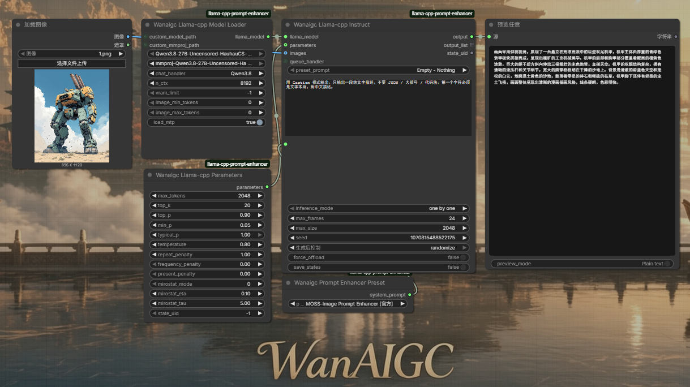

# ComfyUI-llama-cpp-prompt-enhancer  
Local prompt enhancement for ComfyUI powered by llama.cpp, run LLM models natively to refine & generate image prompts.  
**[[📃中文版](./README_zh.md)]** 

## Preview  


## Features  
- **Local prompt enhancement** — Refine & expand your image prompts with local LLM/VLM models (llama.cpp based): fully offline, no API keys.
- **Multiple prompt styles** — Built-in presets: Tags, Simple, Detailed, Extreme Detailed, Cinematic, plus a Creative *Refine & Expand* mode.
- **Model-specific prompt skills** — Prebuilt skills for **Minimax H3**, **Krea 2**, **Moss Image**, **Qwen Image 2.1** to craft prompts optimized for each model.
- **VLM image-to-prompt** — Load vision models with `mmproj` weights (incl. Qwen mode) to generate prompts directly from images.
- **Preset system** — Save, manage and reuse your own prompt presets (Preset Manager / Save Prompt Preset).
- **Structured output tools** — Parse JSON from model responses, convert to BBoxes / SEGS / MASK for grounding workflows, and unpack markdown code blocks.
- **Any model path** — Load `.gguf` models & `mmproj` from any absolute path (not limited to `ComfyUI/models/LLM`); connect directly from the Wanaigc File Finder.
- **Model management nodes** — Loader, Parameters, Unload Model, Clean States, and a BETA Text Encoder node for fine-grained control.

## Installation  

#### Install the node:  
```bash
cd ComfyUI/custom_nodes
git clone https://github.com/wanaigc/ComfyUI-llama-cpp-prompt-enhancer.git
python -m pip install -r ComfyUI-llama-cpp-prompt-enhancer/requirements.txt
#For CUDA 13.1, please run:
#python -m pip install -r ComfyUI-llama-cpp-prompt-enhancer/requirements_cu131.txt
```

#### Download models:  
- **Model download:** [Qwen3.8-27B-Uncensored-HauhauCS-Aggressive-MTP-GGUF (HuggingFace)](https://huggingface.co/HauhauCS/Qwen3.8-27B-Uncensored-HauhauCS-Aggressive-MTP-GGUF) | [夸克网盘](https://pan.quark.cn/s/dd0ba0851a01)  
- Place your model files in the `ComfyUI/models/LLM` folder.  
- Supports **any GGUF-format LLM model** (text-only LLMs, or VLM models with a matching `mmproj` weights file).  

	> If you need a VLM model to process image input, don't forget to download the `mmproj` weights.

## Credits  
- [ComfyUI-llama-cpp](https://github.com/lihaoyun6/ComfyUI-llama-cpp) @lihaoyun6  
- [llama-cpp-python](https://github.com/JamePeng/llama-cpp-python) @JamePeng  
- [ComfyUI-llama-cpp](https://github.com/kijai/ComfyUI-llama-cpp) @kijai  
- [ComfyUI](https://github.com/comfyanonymous/ComfyUI) @comfyanonymous
